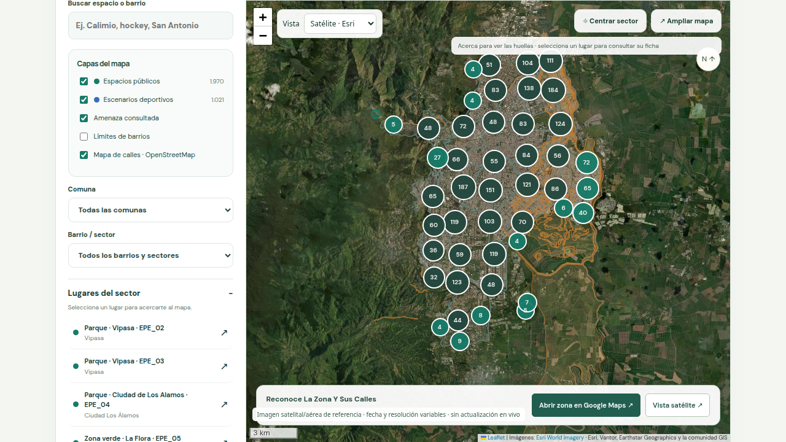
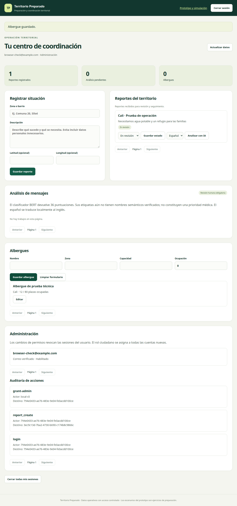
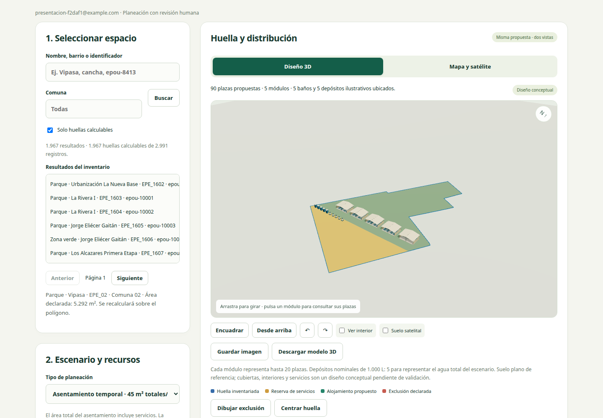
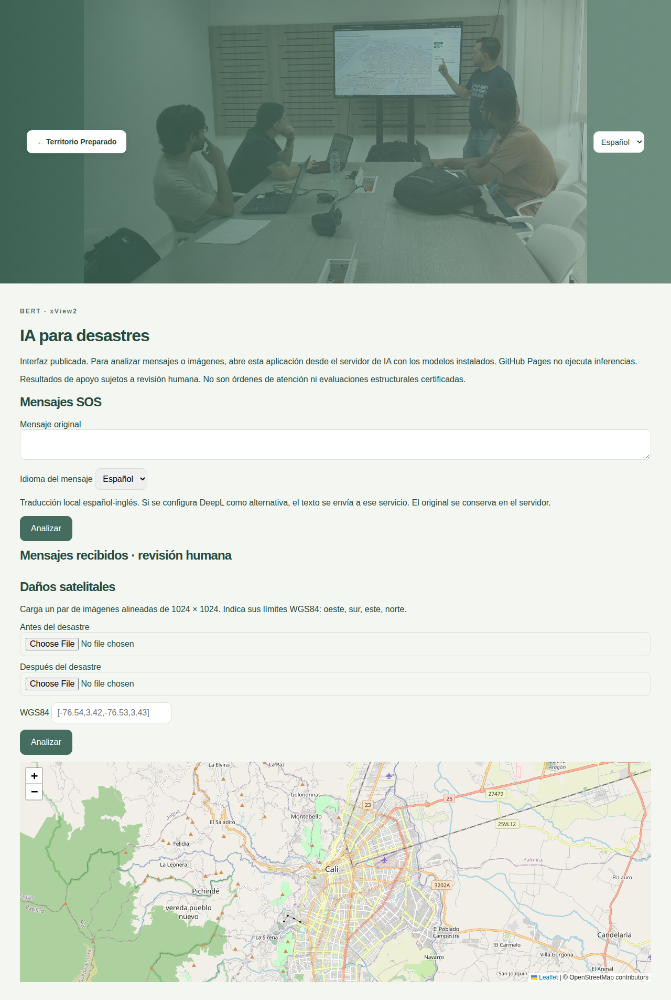

# Territorio Preparado

**Tecnología para conocer el territorio, preparar espacios y coordinar ayudas ante emergencias.**

Proyecto colaborativo con enfoque inicial en Cali, Colombia. Integra exploración territorial, simulación 3D, planificación de albergues, gestión de reportes e inteligencia artificial para apoyar la revisión de mensajes de emergencia.

[Ver aplicación en GitHub Pages](https://helynecheverry.github.io/Territorio-Preparado/)


## Mi participación: liderazgo y desarrollo

Como **CEO del equipo**, mi participación combina la dirección del proyecto con el desarrollo técnico. También represento al equipo en la **misión empresarial en Barcelona del 3 de noviembre de 2026**, como parte de su proyección empresarial.

Mis aportes abarcan el **backend, el frontend y la integración de MongoDB y modelos de inteligencia artificial**. Esta versión de portafolio en [helynecheverry/Territorio-Preparado](https://github.com/helynecheverry/Territorio-Preparado) presenta ese trabajo dentro del proyecto colectivo y conserva los créditos del equipo.

| Área | Mi aporte | Código y documentación relacionados |
| --- | --- | --- |
| Dirección y representación | Liderazgo del equipo como CEO y representación en la misión empresarial en Barcelona. | Dirección del proyecto |
| Backend | Desarrollo de la API en Rust y de los servicios para la operación de la aplicación. | [Backend](backend/), [configuración](backend/src/config.rs) y [dominio](backend/src/domain/) |
| Frontend | Desarrollo de interfaces y conexión de los módulos con los servicios del backend. | [Aplicación web](backend/web/) y [frontend del proyecto](frontend/) |
| MongoDB | Integración de la persistencia para usuarios, sesiones, reportes, trabajos de IA y propuestas de planeación. | [Conexión e índices](backend/src/db.rs) |
| Inteligencia artificial | Integración de modelos y del flujo de procesamiento de mensajes con persistencia de trabajos y resultados. | [Módulos de IA](backend/src/ai/) y [servicio experimental](servidor/ia/) |

La contribución en IA corresponde a **integración e inferencia con modelos existentes**. El repositorio no documenta entrenamiento de un modelo fundacional propio. Las funcionalidades generales son resultado del trabajo del equipo; esta tabla describe mi participación, sin atribuirme la autoría exclusiva del proyecto.

## La aplicación y sus módulos

| Módulo | Función |
| --- | --- |
| Explorador territorial | Consulta espacios públicos, escenarios deportivos, barrios y capas de referencia en mapas y vista satelital. |
| Demostración de refugio | Presenta una visualización conceptual para explorar soluciones de alojamiento. |
| Preparar intervención | Permite explorar propuestas de intervención sobre espacios seleccionados. |
| Análisis preventivo | Presenta información para ejercicios de preparación territorial. |
| El kit | Muestra elementos ilustrativos de dotación para refugios. |
| Simulación | Permite explorar escenarios y propuestas en un entorno 3D. |
| Centro de operaciones | Reúne demostraciones de consolidación de reportes y la propuesta de operación con IA local. |
| Centro de coordinación | Gestiona reportes, análisis de mensajes, albergues y administración desde la aplicación Rust. |
| Planificador de albergues | Calcula propuestas sobre huellas del inventario y compara capacidad, recursos y exclusiones. |
| IA para desastres | Ofrece interfaces para mensajes SOS y evaluación satelital experimental; requiere los servicios y modelos correspondientes. |

### Explorador territorial y mapa satelital

Consulta del inventario territorial con filtros y capas de referencia.



### Centro de coordinación

Reportes del territorio, análisis de mensajes, gestión de albergues y administración. La captura muestra datos de prueba.



### Planificación de albergues

Selección de espacios, cálculo de capacidad y comparación de recursos para una propuesta sujeta a revisión.


### Diseño 3D

Visualización conceptual de la distribución sobre la huella seleccionada, con opciones de exportación PNG y GLB.



### Inteligencia artificial para desastres

Interfaz de mensajes SOS y evaluación satelital del prototipo experimental. Esta captura corresponde a la interfaz estática: no muestra una inferencia ejecutada.



Las capturas corresponden a distintas vistas y etapas del prototipo. Los resultados de planeación son ejercicios ilustrativos; las imágenes satelitales son referencias de contexto.

## Estado actual

- Interfaz pública con explorador territorial, mapas y simulador 3D.
- Backend en Rust con autenticación, roles, reportes y gestión de albergues.
- MongoDB para usuarios, sesiones, reportes, trabajos de IA y propuestas de planeación.
- Planificador con cálculo de capacidad, recursos y distribución conceptual en 3D.
- Integración local de BERT y Marian para procesamiento de mensajes. La evaluación satelital con xView2 pertenece al servicio experimental Python y requiere su runtime.

## Lo que queremos lograr

Consolidar una plataforma que ayude a equipos e instituciones a prepararse antes de una emergencia, identificar espacios aprovechables y coordinar información y recursos.

Los siguientes pasos son validar los resultados de IA y de planeación con especialistas, completar las funciones experimentales e incorporar fuentes oficiales y conectores operativos. El despliegue de los servicios debe permitir una operación persistente con control de acceso y seguimiento de los reportes.

## GitHub Pages

**[Abrir la demostración](https://helynecheverry.github.io/Territorio-Preparado/)**

GitHub Pages muestra la interfaz estática y el simulador. El backend, MongoDB y las inferencias de IA requieren un servidor independiente.

El [workflow incluido](.github/workflows/pages.yml) publica `frontend/dist` cuando se actualiza `main`. Para habilitarlo, selecciona **Settings → Pages → Source → GitHub Actions** en este repositorio. El enlace estará disponible cuando el despliegue termine correctamente.

## Ejecutar la interfaz localmente

```bash
python3 -m http.server 4173 --bind 127.0.0.1 --directory frontend/dist
```

Abrir **http://127.0.0.1:4173/**. Para ejecutar la aplicación completa, consulta la [instalación del backend](backend/README.md#arranque-de-desarrollo).

## Equipo y alcance

Proyecto de origen: [bryanmavi/Territorio-Preparado](https://github.com/bryanmavi/Territorio-Preparado).

Equipo acreditado en el proyecto: **William Ortiz, Herlin Echeverry, Pablo Arango y Bryan Martinez Villamarin**. La sección de participación personal complementa estos créditos.

Territorio Preparado es un prototipo de preparación y apoyo a la coordinación. Incluye datos sintéticos y funciones experimentales; los resultados de IA y las propuestas de albergues requieren revisión humana. No constituye una validación operativa para la atención de emergencias reales.
