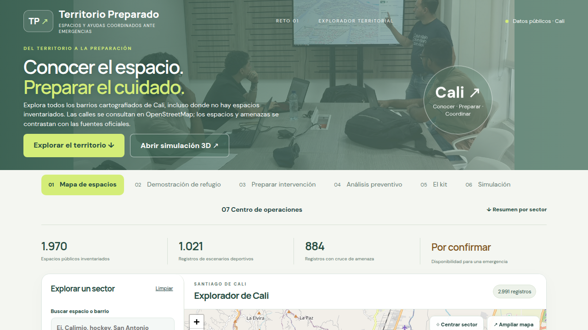
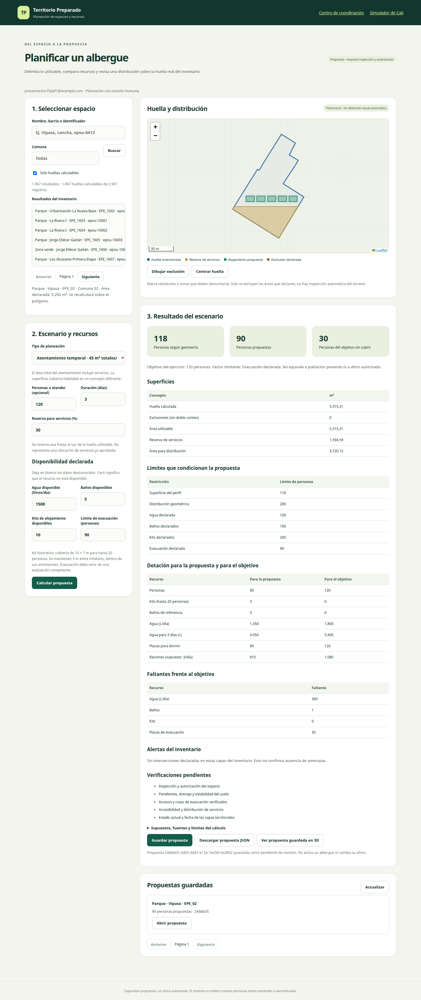
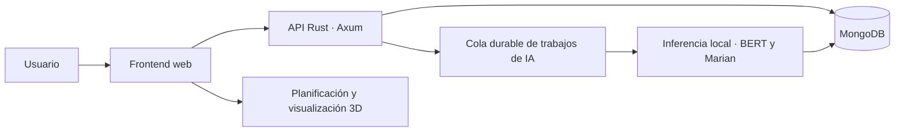

# Territorio Preparado

**Tecnología para conocer el territorio, preparar espacios y coordinar ayudas ante emergencias.**

Proyecto colaborativo con enfoque inicial en Cali, Colombia. Integra exploración territorial, simulación 3D, planificación de albergues, gestión de reportes e inteligencia artificial para apoyar la revisión de mensajes de emergencia.

[Ver demostración del equipo](https://bryanmavi.github.io/Territorio-Preparado/) · [Backend y API](backend/README.md) · [Documento del proyecto](Territorio_Preparado_Actualizado.md)



## Mi participación: liderazgo y desarrollo

Como **CEO del equipo**, mi participación combina la dirección del proyecto con el desarrollo técnico. También represento al equipo en la **misión empresarial en Barcelona del 3 de noviembre de 2026**, como parte de su proyección empresarial.

Mis aportes abarcan el **backend, el frontend y la integración de MongoDB y modelos de inteligencia artificial**. Esta versión de portafolio en [helynecheverry/Territorio-Preparado](https://github.com/helynecheverry/Territorio-Preparado) presenta ese trabajo dentro del proyecto colectivo y conserva los créditos del equipo.

| Área | Mi aporte | Código y documentación relacionados |
| --- | --- | --- |
| Dirección y representación | Liderazgo del equipo como CEO y representación en la misión empresarial en Barcelona. | [Propuesta del proyecto](Territorio_Preparado_Actualizado.md) |
| Backend | Desarrollo de la API en Rust y de los servicios para la operación de la aplicación. | [Backend](backend/), [configuración](backend/src/config.rs) y [dominio](backend/src/domain/) |
| Frontend | Desarrollo de interfaces y conexión de los módulos con los servicios del backend. | [Aplicación web](backend/web/) y [frontend del proyecto](frontend/) |
| MongoDB | Integración de la persistencia para usuarios, sesiones, reportes, trabajos de IA y propuestas de planeación. | [Conexión e índices](backend/src/db.rs) |
| Inteligencia artificial | Integración de modelos y del flujo de procesamiento de mensajes con persistencia de trabajos y resultados. | [Módulos de IA](backend/src/ai/) y [servicio experimental](servidor/ia/) |

La contribución en IA corresponde a **integración e inferencia con modelos existentes**. El repositorio no documenta entrenamiento de un modelo fundacional propio. Las funcionalidades generales son resultado del trabajo del equipo; esta tabla describe mi participación, sin atribuirme la autoría exclusiva del proyecto.

## La aplicación y sus módulos

| Módulo | Función |
| --- | --- |
| Explorador territorial | Consulta espacios públicos, escenarios deportivos, barrios y capas de referencia en mapas y vista satelital. |
| Demostración de refugio | Presenta una visualización conceptual para explorar soluciones de alojamiento. |
| Preparar intervención | Permite explorar propuestas de intervención sobre espacios seleccionados. |
| Análisis preventivo | Presenta información para ejercicios de preparación territorial. |
| El kit | Muestra elementos ilustrativos de dotación para refugios. |
| Simulación | Permite explorar escenarios y propuestas en un entorno 3D. |
| Centro de operaciones | Reúne demostraciones de consolidación de reportes y la propuesta de operación con IA local. |
| Centro de coordinación | Gestiona reportes, análisis de mensajes, albergues y administración desde la aplicación Rust. |
| Planificador de albergues | Calcula propuestas sobre huellas del inventario y compara capacidad, recursos y exclusiones. |
| IA para desastres | Ofrece interfaces para mensajes SOS y evaluación satelital experimental; requiere los servicios y modelos correspondientes. |

### Explorador territorial y mapa satelital

Consulta del inventario territorial con filtros y capas de referencia.


### Centro de coordinación

Reportes del territorio, análisis de mensajes, gestión de albergues y administración. La captura muestra datos de prueba.


### Planificación de albergues

Selección de espacios, cálculo de capacidad y comparación de recursos para una propuesta sujeta a revisión.



### Diseño 3D

Visualización conceptual de la distribución sobre la huella seleccionada, con opciones de exportación PNG y GLB.


### Inteligencia artificial para desastres

Interfaz de mensajes SOS y evaluación satelital del prototipo experimental. Esta captura corresponde a la interfaz estática: no muestra una inferencia ejecutada.


Las capturas corresponden a distintas vistas y etapas del prototipo. Los resultados de planeación son ejercicios ilustrativos; las imágenes satelitales son referencias de contexto.

## Arquitectura y tecnologías



| Componente | Tecnologías y alcance |
| --- | --- |
| Aplicación operativa | Rust, Axum y Tokio; autenticación, roles, reportes, albergues y administración. |
| Persistencia | MongoDB para la aplicación Rust; SQLite en los prototipos Python. |
| IA local en Rust | Candle, clasificación BERT SOS y traducción Marian español–inglés. |
| Interfaz | JavaScript, HTML/CSS, aplicación React compilada y visualización 3D. |
| Cartografía | Leaflet, OpenStreetMap y capas satelitales de referencia. |
| Servicios experimentales | Python/FastAPI y adaptador xView2 para imágenes antes/después. |
| Despliegue preparado | Docker Compose y Caddy; configuración adicional del servicio IA en `deploy/ia/`. |

**Estado de la IA:** BERT devuelve puntuaciones cuyas etiquetas semánticas requieren verificación. xView2 pertenece al servicio experimental Python, requiere provisionar su runtime y no está migrado al backend Rust. SAM permanece pendiente. Consulta [el estado y los requisitos de los modelos](servidor/ia/README.md).

## Ejecutar localmente

### Aplicación con backend Rust y MongoDB

Requiere Rust 1.88 o superior, compilador C y MongoDB activo. Los modelos necesitan sus pesos locales; no están incluidos en Git.

```bash
cd backend
./scripts/run-local.sh
```

Abrir **http://127.0.0.1:4180/app/**. El planificador está en **http://127.0.0.1:4180/app/planner.html**.

La [guía del backend](backend/README.md#arranque-de-desarrollo) explica la configuración, el registro, el segundo factor por correo y la habilitación del primer administrador.

### Interfaz estática y simulador

Desde la raíz, con Python 3:

```bash
python3 -m http.server 4173 --bind 127.0.0.1 --directory frontend/dist
```

Abrir **http://127.0.0.1:4173/** y seleccionar **06 Simulación** para acceder al laboratorio.

La entrega incluye la aplicación React compilada; sus fuentes originales y su configuración de compilación no están disponibles en esta copia. Se conservan los scripts de mantenimiento y los fuentes del simulador. El frontend operativo de Rust está en `backend/web/`.

### Servicios Python experimentales

- [Servidor de demostración](servidor/README.md): consolidación de datos sintéticos y conector opcional a un modelo local.
- [Servicio IA](servidor/ia/README.md): instalación de modelos, inferencias y pruebas.

Estos servicios y el backend Rust utilizan por defecto el puerto 4180; ejecutar solo uno en ese puerto.

## Publicación y procedencia

La [demostración enlazada](https://bryanmavi.github.io/Territorio-Preparado/) corresponde al repositorio del equipo. GitHub Pages publica la interfaz estática; las inferencias y MongoDB requieren un servidor independiente.

Este repositorio incluye un [workflow de Pages](.github/workflows/pages.yml) que prepara `frontend/dist` para el nombre del repositorio y lo publica al actualizar `main`. La configuración de despliegue debe habilitarse en el repositorio de destino.


## Documentación

- [Backend: instalación, API y despliegue](backend/README.md).
- [Planificación de albergues: método y supuestos](backend/PLANNING.md).
- [Diseño 3D, mapas y alcance](backend/DESIGN_AND_MAPS.md).
- [Servidor propio, IA y vigilancia](docs/SERVIDOR_PROPIO_IA_Y_VIGILANCIA.md).
- [Fuentes de datos](docs/DATASETS.md) y [fuentes del simulador](frontend/simulation-source/README.md).
- Documento del proyecto: [Markdown](Territorio_Preparado_Actualizado.md), [PDF](Territorio_Preparado_Actualizado.pdf) y [Word](Territorio_Preparado_Actualizado.docx).
- [Presentación del proyecto](Territorio_Preparado_Pitch.pdf).

## Equipo y alcance

Proyecto de origen: [bryanmavi/Territorio-Preparado](https://github.com/bryanmavi/Territorio-Preparado).

Equipo acreditado en el proyecto: **William Ortiz, Herlin Echeverry, Pablo Arango y Bryan Martinez Villamarin**. La sección de participación personal complementa estos créditos.

Territorio Preparado es un prototipo de preparación y apoyo a la coordinación. Incluye datos sintéticos y funciones experimentales; los resultados de IA y las propuestas de albergues requieren revisión humana. No constituye una validación operativa para la atención de emergencias reales.
